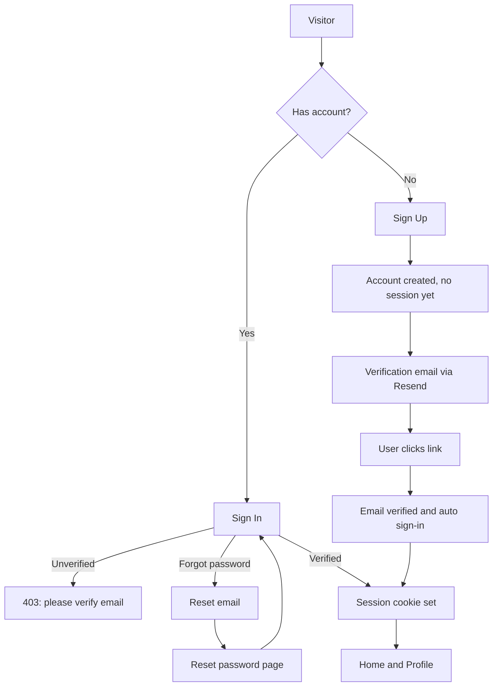

<div align="center">

# 🛡️ NextAuth Pro

### Secure, fast and modern authentication for Next.js, powered by Better Auth

[](https://nextjs.org/)
[](https://www.better-auth.com/)
[](https://www.heroui.com/)
[](https://tailwindcss.com/)
[](https://www.mongodb.com/)
[](https://resend.com/)

[Live Demo](https://sofian-advanced-betterauth.vercel.app/) · [Report a Bug](../../issues) · [Request a Feature](../../issues)

</div>

---

## 📑 Table of Contents

- [About the Project](#-about-the-project)
- [Features](#-features)
- [Tech Stack](#-tech-stack)
- [Architecture](#-architecture)
  - [Folder Structure](#folder-structure)
  - [Authentication Flow](#authentication-flow)
  - [Route Protection (Two Layers)](#route-protection-two-layers)
  - [Server vs Client Components](#server-vs-client-components)
- [Getting Started](#-getting-started)
  - [Prerequisites](#prerequisites)
  - [Installation](#installation)
  - [Environment Variables](#environment-variables)
  - [OAuth Setup](#oauth-setup)
  - [Email Setup (Resend)](#email-setup-resend)
- [Deployment](#-deployment)
- [Challenges Overcome](#-challenges-overcome)
- [Future Improvements](#-future-improvements)
- [Security Notes](#-security-notes)
- [Author](#-author)

---

## 📖 About the Project

**NextAuth Pro** is a complete, production-style authentication system built with **Next.js (App Router)** and **Better Auth**. It covers the whole account lifecycle: sign up with email verification, sign in with email or social providers, password recovery, and a protected profile where users manage their name, email and password.

The goal was to go beyond a basic login form and build something that handles the real edge cases: unverified emails, expired reset links, protected routes, safe redirects and email delivery failures. It also has a consistent dark "aurora" design with loading states, toasts and accessible, keyboard-friendly components.

> **Live demo:** https://sofian-advanced-betterauth.vercel.app/

---

## ✨ Features

### 🔐 Authentication

- **Email and password** sign up and sign in with client-side validation
- **Google and GitHub OAuth** (new users are created automatically on first sign-in)
- **Email verification** required before sign in, with an automatic sign-in after the link is clicked
- **Remember me** option controlling session persistence
- **Forgot and reset password** flow with single-use, expiring tokens
- **Account linking**: the same email via Google and GitHub joins one account
- **Sign out** with a loading toast and a session refresh

### 👤 Profile Management

- **Protected `/profile` page**, validated on the server
- **Update name** (the Save button enables only when the value changed)
- **Change email** with a confirmation link sent to the current address and prevent already register email to change using emailTakenByAnotherUser
- **Change password** with current, new and confirm fields and a strength meter
- **Sign out of other devices** after a password change
- **Resend verification email** with a 60-second cooldown
- **Linked sign-in methods** shown as chips (Email, Google, GitHub)
- **Profile strength ring** calculated from real account data
- Social-only accounts see an explanation instead of a password form that could never work

### 🛡️ Security

- **Two-layer route protection**: `proxy.js` checks the cookie, and the server page validates the session
- **Open-redirect protection** on the `callbackURL` parameter (`safeRedirect`)
- **User-enumeration protection**: identical responses on forgot-password, and the sign-up notice does not leak which emails exist
- **Reset token privacy**: `referrer: no-referrer` on the reset page
- **HTML-escaped email templates** so user-supplied text cannot inject markup
- **Strong password rules** (8+ characters, uppercase and number) with a live strength meter
- **Optional sessions revocation** on password reset and password change

### 🎨 UI / UX

- Modern dark **aurora** theme with an animated gradient card border and a cursor-following spotlight
- Two-column auth layouts (brand panel + form panel) that collapse cleanly on mobile
- **Session-aware navbar**: avatar dropdown (Profile, Sign out) when signed in, Sign In / Sign Up when signed out, with no loading flash because the session is read on the server
- **Sonner toasts** for every action: loading, success, error and warning states, custom styled
- **Premium splash screen** with progress and status messages (once per session)
- **Skeleton loading page** for `/profile` that mirrors the real layout
- **Custom 404 page**
- **Branded HTML emails** (verification, reset password, change email)
- Respects `prefers-reduced-motion`, with ARIA labels, focus rings and keyboard navigation in the user menu

### 🔎 SEO

- Per-page **metadata** with a title template
- Generated **Open Graph and Twitter images**
- `robots.js` and `sitemap.js`
- Auth pages set to `noindex`

---

## 🧰 Tech Stack

| Layer | Technology |
| --- | --- |
| Framework | [Next.js](https://nextjs.org/) (App Router, Server Components, Server Actions) |
| UI library | [React](https://react.dev/) |
| Components | [HeroUI](https://www.heroui.com/) |
| Styling | [Tailwind CSS v4](https://tailwindcss.com/) |
| Icons | [Lucide React](https://lucide.dev/) |
| Authentication | [Better Auth](https://www.better-auth.com/) |
| Database | [MongoDB](https://www.mongodb.com/) via Better Auth's MongoDB adapter |
| Email | [Resend](https://resend.com/) |
| Notifications | [Sonner](https://sonner.emilkowal.ski/) |
| Hosting | [Vercel](https://vercel.com/) |

---

## 🏗 Architecture

### Folder Structure

```text
.
├── proxy.js                         # Optimistic route protection (cookie check)
├── src/
│   ├── app/
│   │   ├── layout.jsx               # Root metadata, <Toaster />, <SplashScreen />
│   │   ├── page.jsx                 # Home (async server component, reads session)
│   │   ├── not-found.jsx            # Custom 404
│   │   ├── opengraph-image.jsx      # Generated social image
│   │   ├── robots.js
│   │   ├── sitemap.js
│   │   ├── api/auth/[...all]/       # Better Auth route handler
│   │   ├── actions/
│   │   │   └── check-email.js       # Server actions: emailExists / emailTakenByAnotherUser
│   │   ├── (auth)/
│   │   │   ├── sign-in/page.jsx
│   │   │   ├── sign-up/page.jsx
│   │   │   ├── forgot-password/page.jsx
│   │   │   └── reset-password/page.jsx
│   │   └── profile/
│   │       ├── page.jsx             # Server: validates session, loads providers
│   │       └── loading.jsx          # Skeleton
│   ├── components/
│   │   ├── auth/
│   │   │   ├── auth-shell.jsx       # Shared background, header and animated card
│   │   │   ├── sign-in-form.jsx
│   │   │   ├── sign-up-form.jsx
│   │   │   ├── forgot-password-form.jsx
│   │   │   └── reset-password-form.jsx
│   │   ├── profile/
│   │   │   └── profile-view.jsx     # Tabs: Account, Email, Security
│   │   ├── user-menu.jsx            # Avatar dropdown
│   │   └── splash-screen.jsx
│   ├──lib/
│   |   ├── auth.js                  # Better Auth server config
│   |   ├── auth-client.js           # Better Auth client + named exports
│   |   ├── email.js                 # Resend sender + HTML templates
│   |   ├── safe-redirect.js         # Same-site redirect validator
│   |   └── site.js                  # Site name, description, URL
│   └── proxy.js                     # Middleware, prevent access unauthorized user
└── .env                             # Never committed
```

### Authentication Flow



### Route Protection (Two Layers)

| Layer | File | What it checks | Why |
| --- | --- | --- | --- |
| 1. Optimistic | `proxy.js` | A session cookie **exists** | Fast redirect with no database call |
| 2. Authoritative | `profile/page.jsx` | `auth.api.getSession()` is **valid** | A forged or expired cookie passes layer 1 but fails here |

Signed-out users are redirected to `/sign-in?reason=login-required&callbackURL=/profile`. A warning toast explains why, and after signing in they land back on the page they wanted. The `callbackURL` goes through `safeRedirect()` first.

### Server vs Client Components

| Type | Examples | Responsibility |
| --- | --- | --- |
| **Server** | `page.jsx` files, `app/page.jsx` | Metadata, reading the session, `redirect()`, passing plain serializable props |
| **Client** | `*-form.jsx`, `user-menu.jsx`, `profile-view.jsx` | State, event handlers, toasts, `authClient` calls |

The home page reads the session on the server and passes `user` to the navbar menu as a prop, so the first HTML is already correct and nothing flashes.

---

## 🚀 Getting Started

### Prerequisites

- Node.js 20 or later
- A [MongoDB Atlas](https://www.mongodb.com/atlas) cluster (or local MongoDB)
- A [Resend](https://resend.com/) account and API key
- Google and GitHub OAuth apps (optional, for social login)

### Installation

```bash
# 1. Clone the repository
git clone https://github.com/marleyDip/Programming-Hero_Milestone-07_Module-38-39_NextJS-Advanced-Authentication_BetterAuth-Core.git
cd Programming-Hero_Milestone-07_Module-38-39_NextJS-Advanced-Authentication_BetterAuth-Core

# 2. Install dependencies
npm install

# 3. Create your env file
cp .env.example .env    # then fill in the values below

# 4. Run the dev server
npm run dev
```

Open http://localhost:3000.

### Environment Variables

```env
# Better Auth
BETTER_AUTH_URL=http://localhost:3000
BETTER_AUTH_SECRET=                      # openssl rand -base64 32
BETTER_AUTH_DB_URL=                      # MongoDB connection string

# Site
NEXT_PUBLIC_SITE_URL=http://localhost:3000

# Email (Resend)
RESEND_API_KEY=
EMAIL_FROM="NextAuth Pro <no-reply@yourdomain.com>"

# OAuth
BETTER_AUTH_GOOGLE_CLIENT_ID=
BETTER_AUTH_GOOGLE_CLIENT_SECRET=
BETTER_AUTH_GITHUB_CLIENT_ID=
BETTER_AUTH_GITHUB_CLIENT_SECRET=
```

| Variable | Required | Notes |
| --- | --- | --- |
| `BETTER_AUTH_URL` | ✅ | Must match the URL you browse, with no trailing slash |
| `BETTER_AUTH_SECRET` | ✅ | Long random string |
| `BETTER_AUTH_DB_URL` | ✅ | MongoDB URI |
| `RESEND_API_KEY` | ✅ | From the Resend dashboard |
| `EMAIL_FROM` | ⚠️ | Needs a **verified domain** to email real users |
| OAuth keys | Optional | Only for Google and GitHub login |

### OAuth Setup

Add these **Authorized redirect / callback URLs** in each provider's console:

```text
http://localhost:3000/api/auth/callback/google
http://localhost:3000/api/auth/callback/github

https://<your-domain>/api/auth/callback/google
https://<your-domain>/api/auth/callback/github
```

### Email Setup (Resend)

1. Create an API key in Resend.
2. While testing, the default `onboarding@resend.dev` sender **only delivers to your own Resend account email**. Other recipients get a `403`.
3. For real users, verify a domain in **Resend → Domains** by adding the DNS records (SPF, DKIM, MX).
4. Set `EMAIL_FROM` to an address on that domain and restart the server.

---

## ☁️ Deployment

1. Push the repository to GitHub and import it into **Vercel**.
2. Add every environment variable in **Vercel → Settings → Environment Variables**. Set `BETTER_AUTH_URL` and `NEXT_PUBLIC_SITE_URL` to the production URL.
3. Add the production callback URLs to the Google and GitHub OAuth apps.
4. Add the production URL to `trustedOrigins` in `lib/auth.js`.
5. In MongoDB Atlas, allow Vercel's network access (**Network Access**).
6. Redeploy. Environment changes apply only to new deployments.

---

## 🧗 Challenges Overcome

| Challenge | What went wrong | Solution |
| --- | --- | --- |
| **Social sign-up** | `signUp.social` does not exist in Better Auth, so Google and GitHub sign-up always hit the error path | Use `signIn.social`, which creates the account automatically for new users |
| **Better Auth returns errors, not throws** | `toast.promise` showed "success" even when sign up failed | Throw manually from `.then(({ error }) => ...)`, or use `toast.loading` with a shared `id` |
| **Email verification and no session** | After sign-up the app redirected home, but no session existed yet | Added a "Check your inbox" screen with resend and cooldown |
| **Resend sandbox `403`** | `onboarding@resend.dev` only delivers to the account owner's email, and `void` hid the failure | Logged errors in `send()`, documented the domain verification step, and made the sender configurable with `EMAIL_FROM` |
| **Existing email re-registering** | Sign-up appeared to succeed for registered emails (user-enumeration protection) | Explained the behavior, added honest copy, and two server actions: an open one for sign-up and a **session-checked** one for the profile |
| **`searchParams` and `useSearchParams` errors** | Importing a client hook in a server `page.jsx` broke the build | Server pages read the `searchParams` prop (awaited) and pass values to client forms as props |
| **Protecting routes safely** | A cookie-only proxy check can be fooled by a stale or forged cookie | Added a second, authoritative `getSession()` check on the page |
| **Open redirect risk** | `callbackURL` comes from the URL and could point to another site | Added `safeRedirect()`, which allows only same-site paths and rejects `//` and `\` |
| **Session flash in the navbar** | Client-side `useSession()` showed a skeleton before the avatar | Read the session on the server and pass `user` as a prop, then `router.refresh()` after sign in or out |
| **Dropdown clipped by the hero** | A later `z-10` section painted over the menu | Raised the header stacking context (`z-30`) |
| **Toast close button cut in half** | `overflow-hidden` on the toast clipped Sonner's absolutely positioned button | Moved the close button inside the card and added `!transform-none` |
| **MongoDB connections in dev** | Hot reloads created a new `MongoClient` every time | Cached the client on `globalThis` |
| **Broken Tailwind class** | A line break inside `hover:` and `cursor-pointer` produced an invalid class | Fixed the class strings |
| **Misnested JSX** | The "unverified" banner was inside the "Current email" card | Moved it outside the card |
| **Reset state out of sync** | Resetting the form cleared inputs but not the strength meter or confirm check | Added `onReset` to clear the controlled password state |
| **Server pages vs. metadata** | `metadata` cannot be exported from `"use client"` files | Split each page into a server `page.jsx` and a client form component |

---

## 🔮 Future Improvements

- [ ] **Verify a custom domain in Resend** so emails reach every user
- [ ] **Avatar upload** (UploadThing, Cloudinary or S3) with `updateUser({ image })`
- [ ] **Active sessions list** with "revoke this device" (`listSessions`, `revokeSession`)
- [ ] **Delete account** danger zone (`deleteUser`)
- [ ] **Two-factor authentication** (TOTP) and passkeys
- [ ] **Rate limiting** (for example Upstash) on the email-exists action and auth endpoints
- [ ] **Role-based access** and an admin dashboard
- [ ] **Move shared CSS** (aurora, spin-border, spotlight) into `globals.css` and migrate sign-in and sign-up onto `AuthShell`
- [ ] **Extract shared pieces** (`GoogleIcon`, `GithubIcon`, `Brand`) into one module
- [ ] **Tests**: unit tests for validators and `safeRedirect`, and Playwright end-to-end tests for the auth flows
- [ ] **Light theme** and a theme toggle
- [ ] **Localization** (i18n)
- [ ] **Resend-verification action** inside the unverified-sign-in toast

---

## 🔒 Security Notes

- Never commit `.env`. If a secret was ever committed, **rotate it**.
- Reset and verification tokens are single-use and time-limited, so request a new link if one expires.
- The `proxy.js` check is a convenience layer, not a security boundary. Always validate the session on the server where data is read or changed.
- `emailExists` can reveal whether an address is registered. Add rate limiting before using it on a high-traffic site.

---

## 👨‍💻 Author

<div align="center">

  <h2>✨ Md. Sofian Hasan ✨</h2>

  <p>
    <strong>Software Engineer | Full-Stack (MERN / PERN) Developer</strong>
  </p>

  <p align="center">

[](https://marleydip.netlify.app/)
&nbsp;
[](https://github.com/marleyDip)

</p>

</div>

<p align="center">
  Passionate about building <strong>modern, scalable, and user-focused web applications</strong> while continuously strengthening <b><i>JavaScript, TypeScript, problem-solving, and full-stack development skills</i></b>.
</p>

### 🚀 Tech Focus

<div align="center">


<br /><br />


</div>

If this project helped you, consider giving it a ⭐

---

<div align="center">

Built with ❤️ using Next.js, HeroUI and Better Auth

</div>
